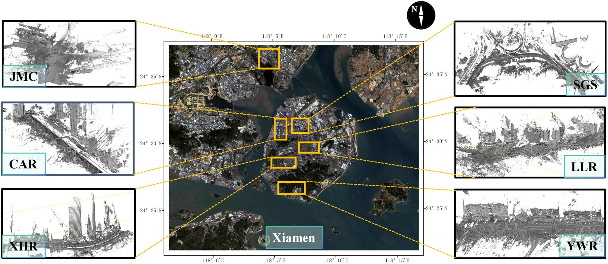

# City-Facade 
This is the Dataset and Code of City-Facade proposed by our paper "City-Facade: Segmentation of Building Facade Elements in Large-Scale 3D Point Clouds".

<b>City-Facade</b> is a large-scale urban building facade dataset for <b>semantic-level and instance-level</b> segmentation from MLS LiDAR point clouds. It consists of labeled point clouds (<b>with 9 classes for building facades</b>) as well as unlabeled data (point clouds of street landscapes). The data collection area encompasses a variety of streets in Xiamen, China, with distinct architectural styles. We believe that our City-Facade will faciliate feature research on point cloud semantic or instance segmentation, urban understanding and modeling, point cloud completion, etc.

## City-Facade Preview




## Dataset Download

Please enjoy this dataset we have provided. 

Click [here](https://drive.google.com/drive/folders/1EX0Dq3_Xj8WcO4CdRxdbaCAVtM4IGS9g?usp=sharing) to download small examples.

Click [BAIDU NETDISK](https://pan.baidu.com/s/1ArP_tUA5ixc0uJSfJz9bSQ?pwd=f3ms) or [GOOGLE DRIVE](https://pan.baidu.com/s/1ArP_tUA5ixc0uJSfJz9bSQ?pwd=f3ms) to download Full Dataset.

To access the Original Dataset, you are welcome to request access to the data owners by email: Ting Han: hant23@mail2.sysu.edu.cn

Disclaimer: The dataset is available for academic research purposes only. To access the data, please contact the data owners using your institution's email address.

Commercial use of the dataset is not authorized without prior consent from the data owners.

For further inquiries or special requests, please reach out to the dataset owners.

## Installation

### Requirements
<ul>
<li>Python 3.6.0 or above</li>
<li>Pytorch 1.2.0 or above</li>
<li>CUDA 10.0 or above</li>
</ul>

### Virtual Environment
````
source install.sh
````

## Data Preparation
(1) View and Download the City-Facade training / testing for building facade segmentation.

(2) Put the data in the corresponding folders, which are organized as follows.
````
data
|--City-Facade
|  |--train
|  |  |--CAR
|  |  |--JMC
|  |  |--SGS
|  |  |--XHR
|  |  |--YWR
|  |--test
|  |  |--CAR
|  |  |--JMC
|  |  |--SGS
|  |  |--XHR
|  |  |--YWR
...
````
## Model Zoo

|Method|Model|OA|mIoU|
|-|-|-|-|
|PointNet|PointNet|74.57|11.87|
|PointNet++|PointNet++|74.76|11.82|
|DGCNN|DGCNN|75.77|11.70|
|DeepGCNs|DeepGCNs|76.04|11.95|
|ASSANet|ASSANet-L|81.61|34.49|
|PointTrans.|PointTrans.|74.83|39.26|
|PointNeXt|PointNeXt-L|78.79|22.19|
|PointVector|PointVector|85.22|36.57|
|PointMetaBase|PointMetaBase-L|86.27|39.34|

## Organizations


## Citation
Our work has been accepted into ISPRS Journal of Photogrammetry and Remote Sensing, please consider citing our work with that reference once it is available! [paper](https://www.sciencedirect.com/science/article/pii/S0924271626000031)
````
@article{chen2026city,
  title={City-Facade: A city-level large-scale point cloud building facade dataset for semantic \& instance segmentation},
  author={Chen, Yiping and Li, Jonathan and Han, Ting and Feng, Huifang and Chen, Jun and Wang, Cheng},
  journal={ISPRS Journal of Photogrammetry and Remote Sensing},
  volume={232},
  pages={675--688},
  year={2026},
  publisher={Elsevier}
}
````

